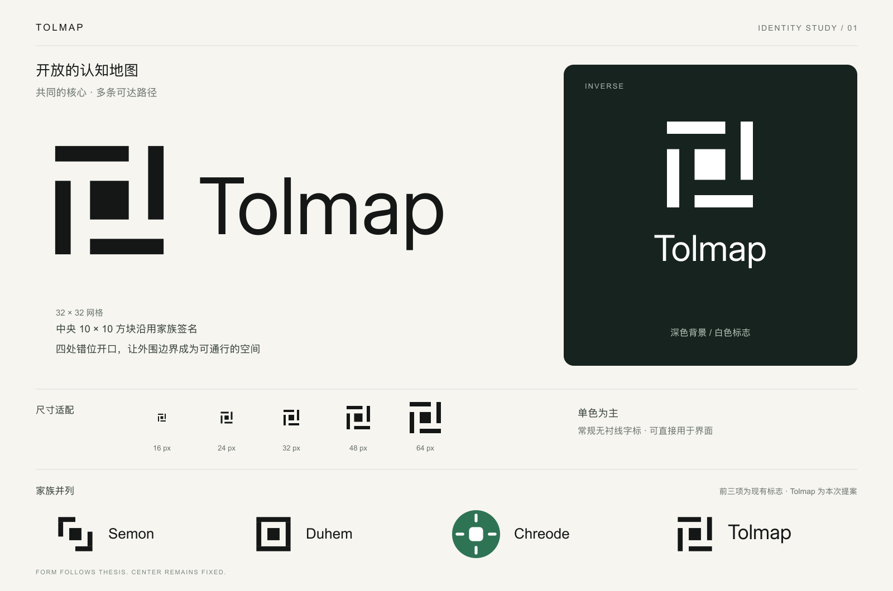

# Tolmap identity

The approved mark represents an open cognitive map: a stable landmark inside
four staggered boundary segments. The openings suggest alternative routes and
shortcuts, reflecting the distinction between strip maps and comprehensive maps
in Tolman's work described in the project README.

## Geometry and family relationship

Tolmap uses Semon and Duhem's 32 × 32 grid and their identical 10 × 10 center
square at (11, 11). Each surrounding segment is four units thick. The openings
distinguish Tolmap from Duhem's closed frame and Semon's opposing brackets.

| Element | x | y | Width | Height |
| --- | --- | --- | --- | --- |
| Top segment | 2 | 2 | 19 | 4 |
| Right segment | 26 | 2 | 4 | 19 |
| Bottom segment | 11 | 26 | 19 | 4 |
| Left segment | 2 | 11 | 4 | 19 |
| Shared center | 11 | 11 | 10 | 10 |

Chreode's current green disc, rounded core and radiating lines remain distinct.
The shared idea is a central core with a thesis-specific surrounding form; the
proposal does not impose the Semon/Duhem grid on Chreode's existing identity.

## Files and use

Downloadable assets live in [`web/public/assets/brand`](../../../web/public/assets/brand).
The directory ships with the web application at `/assets/brand/`.

- `tolmap-mark.svg`: master mark using `currentColor`.
- `tolmap-lockup.svg`: horizontal lockup using `currentColor`.
- `tolmap-wordmark.svg`: outlined Inter Regular wordmark.
- `*-light.svg` / `.png`: black artwork on transparency, for light backgrounds.
- `*-dark.svg` / `.png`: white artwork on transparency, for dark backgrounds.
- `tolmap-{16,24,32,48,64,192,512,1024}.png`: transparent black mark exports.
- `tolmap-app-icon.png`: white mark on Duhem's optional navy accent, `#1E3A5F`.
- `Inter-OFL.txt`: the wordmark font's license and copyright notice.

The default identity is monochrome. Inline SVG uses `currentColor`, so the
application's existing light/dark override controls it without a font download
or a media-query-only image switch. README uses explicit light/dark files.
The adaptive SVG favicon and multi-resolution ICO live directly in `web/public`.

The React exports in `web/src/components/TolmapLogo.tsx` contain the same mark
geometry, lockup transforms and outlined wordmark as the SVG masters. Update
them together if the identity changes. UI typography outside the logo remains
Archivo and IBM Plex Mono as specified in `docs/UX.md`.

Keep the aspect ratio, do not rotate, and avoid gradients or shadows. Standalone
marks should have at least half a canvas width of clear space. Use a minimum
16 px mark canvas. In a lockup, the visible mark matches the wordmark's cap
height, and the gap is one scaled four-unit segment thickness. The smallest
in-app lockup uses a 28 px canvas height, leaving its visible mark about 18 px.

## References

- [Duhem brand rules](https://github.com/onsager-ai/duhem/blob/main/docs/duhem-brand.md)
- [Semon mark](https://github.com/onsager-ai/semon/blob/main/crates/semon-sessions/src/favicon.svg)
- [Chreode mark](https://github.com/onsager-ai/chreode/blob/main/apps/app/web/src/components/ui/ChreodeMark.tsx)
- [Inter font source](https://github.com/google/fonts/tree/main/ofl/inter)

The preview includes existing sister-product marks for comparison. Only Tolmap
assets and integration are changed by this work.
